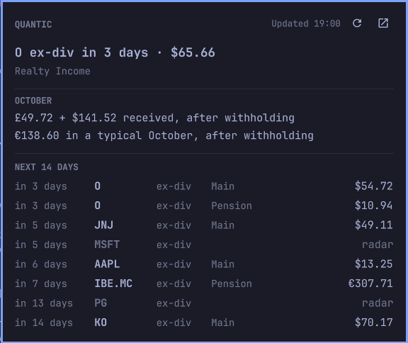

# omarchy-quantic

Your next dividend in the [Omarchy](https://omarchy.org) bar, and the next two weeks in a panel,
from [Quantic Finance](https://quantic.finance).




It's a thin widget over [quantic-cli](https://github.com/fleveque/quantic-cli). Every few minutes it
runs `quantic status --json` and shows what comes back. The CLI handles everything else: signing
in, the API, caching, and staying usable offline.

## What it shows

**The pill** shows your holdings' next ex-dividend date or payment: `O ex-div in 3 days`. Amounts
are hidden by default, because the bar is on screen whenever you share it. Turn them on and the
pill adds what that dividend should pay:


**The panel** (left click) shows:
- the next event with its amount;
- what this month has paid so far, one total per currency (Quantic doesn't convert them, and
  neither does the widget);
- what a typical such month pays, in your preferred currency;
- every ex-date and payment in the next 14 days. Stocks on your Quantic radar are listed
  dimmed, as `radar`.

`r` refreshes, `o` opens Quantic, and `Esc` closes it. A middle click on the pill also refreshes.

**When something's wrong:**

| State | Pill |
|---|---|
| quantic not installed, or not found | the icon, dimmed; the panel says how to fix it |
| not signed in | the icon with a key:  |
| Quantic unreachable, cached answer | the cached text, dimmed; the tooltip and panel say since when:  |
| Quantic unreachable, nothing cached | the icon only |
| one part failed (say, income) | everything else as usual; the panel lists what's missing |

## Install

1. **Install [quantic-cli](https://github.com/fleveque/quantic-cli) v0.1.1 and sign in.** The
   widget needs the `quantic` command. Put it in `~/.local/bin`, which Omarchy keeps on its shell's
   `PATH`, so the widget finds it with no setting. This plugin is reviewed with
   [v0.1.1](https://github.com/fleveque/quantic-cli/releases/tag/v0.1.1), so install that release
   and check it against the checksum here, not one you download with it. On x86-64:

   ```
   curl -fLO https://github.com/fleveque/quantic-cli/releases/download/v0.1.1/quantic_0.1.1_linux_amd64.tar.gz
   echo "0599bd1e4215421c244058fd850d13ff8fb08c0ace2b2a54c214c22099b4a420  quantic_0.1.1_linux_amd64.tar.gz" | sha256sum --check
   tar xzf quantic_0.1.1_linux_amd64.tar.gz quantic
   install -Dm755 quantic ~/.local/bin/quantic
   quantic auth login
   quantic status            # check it works
   ```

   On ARM, the archive is `quantic_0.1.1_linux_arm64.tar.gz`, and its SHA-256 is
   `a8eb093958167be4fa9bf892a6bac30e390ebfe26d070ec49720e0c7af2a43d0`.

   Or, with Go 1.27 or later:

   ```
   GOBIN=~/.local/bin go install github.com/fleveque/quantic-cli/cmd/quantic@v0.1.1
   ```

2. **Add the widget:**

   ```
   omarchy plugin add https://github.com/fleveque/omarchy-quantic.git --enable
   ```

3. **Only if `quantic` is somewhere else** (a plain `go install` puts it in `~/go/bin`), point the
   widget at it:

   ```
   omarchy bar set io.github.fleveque.quantic command ~/go/bin/quantic
   ```

Plugins run inside the Omarchy shell, unsandboxed: read the code before enabling it. It's
`Model.js`, `Panel.qml` and `BarWidget.qml`, about 700 lines. The widget runs only `which` and
`quantic status --json`, plus `xdg-open https://quantic.finance` when you ask it to. It has no token
and makes no network calls of its own. The `portfolio` setting reaches `quantic` as
`QUANTIC_PORTFOLIO` in its environment, which only you can read, never in its arguments, which
anyone on the machine can see with `ps`.

## Settings

Each one is set with `omarchy bar set io.github.fleveque.quantic <key> <value>`:

| Key | Default | |
|---|---|---|
| `refreshMinutes` | `10` | how often to ask; never under 5 |
| `portfolio` | empty | one portfolio by name or slug; empty is all of them, and your radar. Needs quantic-cli 0.1.1 |
| `showAmounts` | `Off` | `On` adds the next dividend's amount to the pill |
| `command` | `quantic` | the quantic binary: a name on `PATH`, or a path (`~/` works) |

## Remove

```
omarchy plugin remove io.github.fleveque.quantic
```

That removes the widget. quantic-cli is separate: `quantic auth logout` deletes your token from the
keyring and empties its cache, and `rm ~/.local/bin/quantic` removes the command.

## The contract

The widget reads [`quantic.cli/status/v1`](https://github.com/fleveque/quantic-cli/blob/main/docs/design.md#8-quantic-status-one-call-for-the-widget)
and quantic's [exit codes](https://github.com/fleveque/quantic-cli/blob/main/docs/design.md#6-exit-codes):
3 for unreachable, 4 for not signed in. A `quantic` that prints another schema version is an error
the panel names, rather than something the widget guesses at.

`test/fixtures/status.json` is a copy of quantic-cli's golden file for `quantic status --json`, and
CI fails when the two differ. When the CLI's output changes, the copy and the widget are updated
together.

## Working on this

```
node --test       # Model.js against the fixtures, and the manifest
```

`Model.js` holds every decision: what an exit code means, the pill's words, the month's lines, the
panel's rows. It's plain JavaScript that the QML imports and node tests. The QML only runs the
process and lays things out, and it's checked by hand. To load a checkout into the shell:

```
ln -s "$PWD" ~/.config/omarchy/plugins/io.github.fleveque.quantic
omarchy-shell shell rescanPlugins
omarchy plugin enable io.github.fleveque.quantic
omarchy-shell io.github.fleveque.quantic refresh     # ask again now
```

`main` is protected: every change goes through a pull request, and CI must pass before merge.

## License

[MIT](LICENSE)
